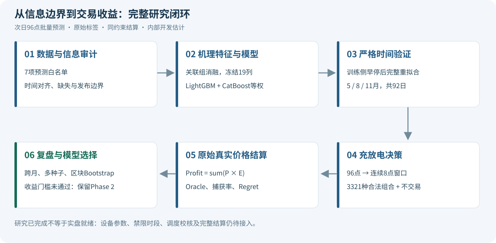
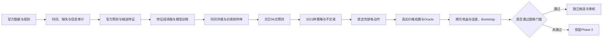
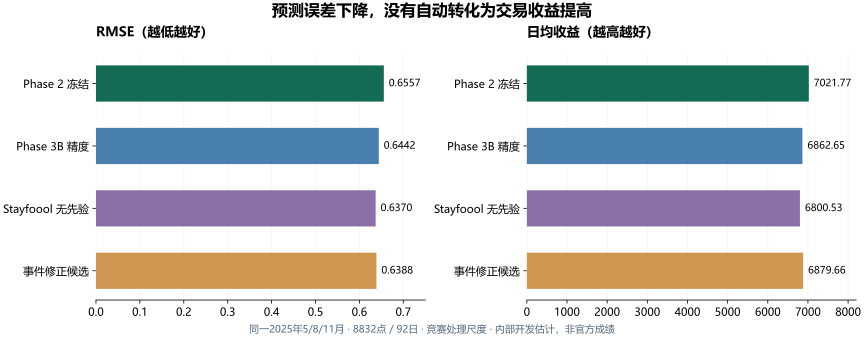
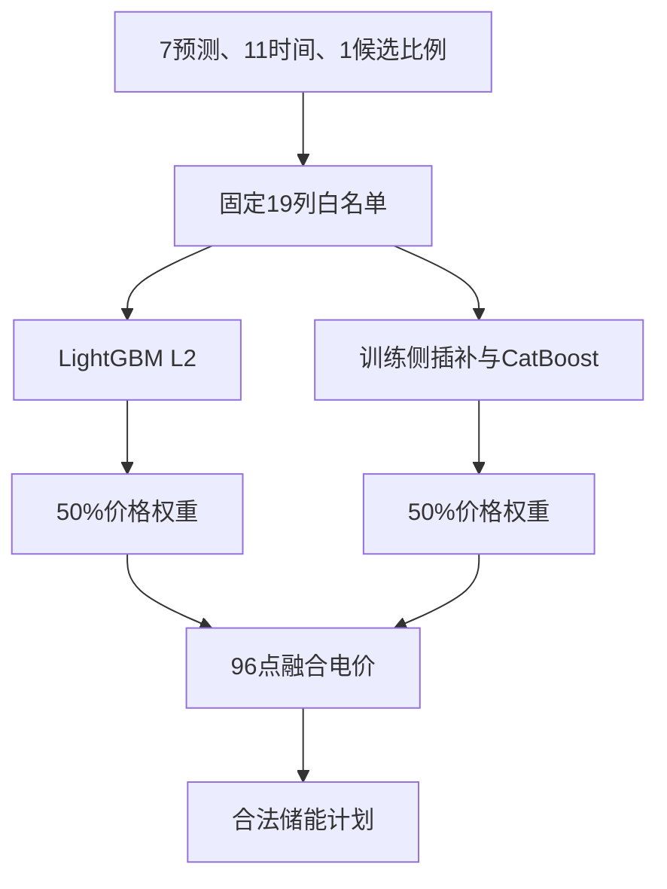
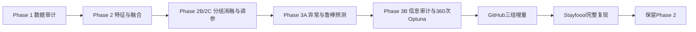

# 蒙西电力现货价格预测与储能交易研究

**第四届世界科学智能大赛 · 电力市场交易赛道｜次日96点实时电价 → 储能计划 → 真实价格结算**

[](https://github.com/ShengPan888/electricity-storage-trading/actions/workflows/tests.yml)
[](LICENSE)

本项目研究：只知道比赛提供的次日预测边界时，如何提前选择连续两小时充电、两小时放电时窗，提高储能实际套利收益。

已完成数据审计、官方基线、供需特征消融、LightGBM/CatBoost融合、异常检测、Optuna精度/收益优化及同赛道Stayfoool方案完整复现。**当前保留Phase 2融合模型：有候选降低了价格误差，但没有通过收益替换门槛。**

更新2026-11-09。真实实验数字均为**内部开发估计**，非官方隐藏测试成绩。12月已被查看，只作诊断；价格和收益使用赛题处理尺度，不换算人民币或未经确认的物理单位。

## 项目导航

| 想了解什么 | 入口 |
|---|---|
| 从数据到交易的完整思路 | [技术路线与8张流程图](docs/architecture.md) |
| 现在的精度和收益 | [统一评价结果](docs/RESULTS.md) · [精确JSON](research/results.json) |
| 为什么调参后仍保留原模型 | [实验演进与选择](docs/experiment_history.md) |
| 模型到底输入哪些特征 | [逐项19列、公式与时点](docs/feature_dictionary.md) · [模型卡](docs/model_card.md) |
| 如何避免未来信息泄漏 | [数据与信息边界](docs/data_contract.md) |
| 电力交易有哪些行业规则，做到了哪些 | [正式文件、业务流程与实现差距](docs/market_rule_guide.md) · [征求稿专项](docs/policy_alignment.md) |
| 没有比赛数据怎样看完整演示 | [下载演示HTML及打开方法](docs/demo/README.md) · 下方运行入口 |

## 1. 完整技术路线





预测对象是**次日实时电价**，充放电计划提前制定。历史真实价格在训练时作标签，回测时作结算依据；当前不把真实前15分钟价格作为输入。

## 2. 最新统一结果

共同验证集合：2025年5月、8月、11月，8832个有效点、92个完整日。R²在合并逐点预测上计算；日收益只在96点完整日期计算。所有方案使用相同储能规则与原始真实价格结算。

| 方案 | R² ↑ | MAE ↓ | RMSE ↓ | 日均收益 ↑ | 捕获率 ↑ |
|---|---:|---:|---:|---:|---:|
| **Phase 2冻结：LightGBM＋CatBoost等权融合** | **0.420983** | **0.450309** | **0.655694** | **7021.77** | **63.93%** |
| Phase 3B：Optuna精度导向融合 | 0.441167 | 0.438821 | 0.644164 | 6862.65 | 62.48% |
| 同赛道Stayfoool完整复现，无策略先验 | 0.453506 | 0.406726 | 0.637013 | 6800.53 | 61.91% |
| 高低价事件修正候选 | 0.450439 | 0.432548 | 0.638798 | 6879.66 | 62.63% |

共同Oracle日均收益10984.23，表示事后已知真实价格时的同约束最优合法收益，不能直接交易。



**为什么不选R²最高的模型？** 收益由所选两个连续8点窗口的真实价差决定，全天误差下降仍可能选错窗口。完整Stayfoool方案预测更准，但日均收益比冻结模型低约3.15%，没有通过替换门槛。

尖峰仍是短板：训练期P95定义下，主验证有112个高价事件点，上表各方案召回率均为0；没有预测阳性时Precision未定义。[完整结果与限制](docs/RESULTS.md)

## 3. 模型输入与结构

当前模型使用**19列＝7官方预测＋11时间特征＋1候选比例**：

- 官方预测：系统负荷、风光总加、联络线、风电、光伏、水电、非市场化机组。
- 时间：hour、minute、dayofweek、month、slot_id，以及slot/weekday/month各自sin、cos。
- `renewable_ratio_candidate`：风光总加预测/负荷预测，分母近零返回缺失。



供需差值是待检验候选，未知单位、缩放和联络线方向下，不能认定为官方物理竞价空间。相关性不解释为因果。冻结模型没有未来实际边界、历史价滞后或气象输入。[模型卡](docs/model_card.md)

### 逐项输入列名（严格按模型顺序）

原始CSV只有`times`＋7预测；时间派生为11列，比例再加1列。历史`A`是训练标签，不是输入。此表只指冻结19列模型，Stayfoool完整方案另用17列。

|序号|输入特征|来源 / 公式|
|---|---|---|
|1|`系统负荷预测值`|同名官方CSV预测列，原值输入|
|2|`风光总加预测值`|同名官方CSV预测列，原值输入|
|3|`联络线预测值`|同名官方CSV预测列，原值输入|
|4|`风电预测值`|同名官方CSV预测列，原值输入|
|5|`光伏预测值`|同名官方CSV预测列，原值输入|
|6|`水电预测值`|同名官方CSV预测列，原值输入|
|7|`非市场化机组预测值`|同名官方CSV预测列，原值输入|
|8|`hour`|北京时间目标时间的小时|
|9|`minute`|北京时间目标时间的分钟|
|10|`dayofweek`|目标日期星期，周一=0|
|11|`month`|目标日期月份|
|12|`slot_id`|hour × 4 + minute // 15|
|13|`slot_sin`|sin(2π × slot_id / 96)|
|14|`slot_cos`|cos(2π × slot_id / 96)|
|15|`weekday_sin`|sin(2π × dayofweek / 7)|
|16|`weekday_cos`|cos(2π × dayofweek / 7)|
|17|`month_sin`|sin(2π × (month − 1) / 12)|
|18|`month_cos`|cos(2π × (month − 1) / 12)|
|19|`renewable_ratio_candidate`|风光总加预测值 / 系统负荷预测值|

7项预测的单位/缩放和联络线方向未确认，不能直接标为MW。官方输入可用于竞赛，不证明其原始版本在真实申报截止前已发布。比例分母绝对值≤1e−12设为缺失；CatBoost插补仅在训练侧拟合。

[完整字典](docs/feature_dictionary.md)逐列解释作用、可用时点和检查，并列明未来实际边界、A、历史价滞后、NWP及其他候选的用途。

## 4. 实验演进



Stayfoool上游固定为[10864ce](https://github.com/Stayfoool/electricity-ai4s-2026/tree/10864ce6f88941cad54bac83161800bb503ed1f2)。原作者协议24项公开指标匹配，之后用共同日期、训练侧早停、三种子和统一结算比较。复现成功不等于取得官方排行榜成绩。[演进记录](docs/experiment_history.md)

## 5. 储能优化

每个日期96点，初始SOC=0、容量8000。连续8点充电，动作−1000；之后连续8点放电，动作＋1000；其他为0。每日最多一个完整循环，也可不交易。

- 充电起点 `0≤tc≤80`；放电起点 `tc+8≤td≤88`。
- 合法组合 `81+80+…+1=3321`，另加不交易。
- 最优预测收益不为正时不交易；真实收益严格按 `Profit=sum(P×E)`。
- 不额外乘0.25，不擅自加入效率、费用或衰减。

[优化器](src/storage_trading/core.py)检查SOC、连续性、先充后放、边界和单循环。真实设备效率、可用容量、调节速率、禁限时段、调度校核及完整结算**尚未实现**。[政策边界](docs/policy_alignment.md)

### 竞赛策略与真实电力交易规范，具体差在哪

真实业务先确认市场、交易身份、适用时间和文件版本，再走“注册→披露→预测→申报→校核与调度→计量结算→复盘”。目前实现的是竞赛预测、固定规则策略与离线原价结算。

|规范层次|已核查的官方材料|本项目对应及缺口|
|---|---|---|
|国家运行框架|[2024年第20号令《电力市场运行基本规则》](https://zfxxgk.ndrc.gov.cn/wap/iteminfo.jsp?id=20379)|注册、交易校核、统一调度、计量结算和披露均有制度要求；单站优化不替代这些环节|
|国家储能注册条件|[国能发监管规〔2024〕76号](https://zfxxgk.nea.gov.cn/2024-09/13/c_1212399683.htm)第11条|并网调度、分时计量/传输和设备技术条件；竞赛没有接入真实主体和设备|
|蒙西正式规则体系|[内能源电力发〔2024〕33号](https://nyj.nmg.gov.cn/zwgk/zfxxgkzl/fdzdgknr/xzgfxwj/202412/t20241231_2646354.html)|通知明确自2025-01-01施行；这是2025研究规则检索起点，不宣称逐条认证或穷尽修订|
|2026中长期安排|[内能源电力字〔2025〕783号](https://nyj.nmg.gov.cn/tzgg/202512/t20251230_2843227.html)第七部分|独立储能发/用电单元、中长期合约安全校核；不当作完整现货细则，不倒推2025|
|2026修订征求稿|[2026-02-14征求意见公告](https://nyj.nmg.gov.cn/tzgg/202602/t20260214_2863478.html)|禁充禁放、SOC和时段等作草案差距对照；未取得整体生效确认，不直接编入当前约束|

预测实时价不是市场分段报价，合法比赛曲线不保证市场原样执行，`ΣP×E`也不是计入全部合约与费用后的实盘净收益。详细[R01—R10逐项对照](docs/market_rule_guide.md)列明已做、未做和缺失输入；缺火电上下限、备用等数据时，不用7列假算官方禁限公式。

## 6. 运行Demo与复现

### A. 无数据：合成策略Demo

Python≥3.10，无第三方依赖：

```bash
git clone https://github.com/ShengPan888/electricity-storage-trading.git
cd electricity-storage-trading
python run.py demo
python run.py test
```

打开 `outputs/demo/report.html` 查看价格、动作和SOC。合成曲线只演示规则，不是训练结果或比赛成绩。

### B. 无数据：最新研究概览

```bash
python run.py research-report --output outputs/research
```

打开 `outputs/research/index.html` 离线浏览完整19特征、教学变换示例、业务流程、行业规范差距、真实汇总与候选对照。也可直接下载仓库内的[完整演示HTML](docs/demo/index.html)，打开方法见[说明](docs/demo/README.md)。该命令读取公开汇总，**不重训模型、不捏造结果**。

### C. 持有官方数据：复现冻结Phase 2规格

```bash
python -m pip install -r requirements-research.txt
python run.py reproduce-phase2 --data-dir /path/to/to_sais_new --output outputs/phase2_new_run
```

输入目录含`train/mengxi_boundary_anon_filtered.csv`及`train/mengxi_node_price_selected.csv`，也支持本地官方ZIP。[配置](configs/phase2_frozen.json)固定19列、参数、内层14天早停及5/8/11月验证。保存版本、输入哈希、模型、预测、动作和收益；拒绝覆盖已有运行。[详细说明](research/README.md)

旧`real-demo`仍提供11特征单LightGBM教学版与逐日交互页面，**不是上述最新融合模型**：

```bash
python -m pip install -r requirements-model.txt
python run.py real-demo --data-dir /path/to/to_sais_new --output outputs/legacy_real_demo
```

已有预测可用`backtest --predictions ...`作真实价格结算，或`submit --predictions ...`只读预测生成动作，见[数据契约](docs/data_contract.md)。

## 7. 仓库结构

```text
configs/phase2_frozen.json       冻结参数与时间划分
src/storage_trading/
  core.py                       3321组合、SOC与结算
  research.py                   最新19特征融合复现
  research_report.py            公开研究结果离线页面
  pipeline.py                   早期11特征教学流水线
  cli.py                        Demo、回测与策略导出
research/                       汇总结果、来源哈希和原环境
scripts/render_research_assets.py 图示生成与公开记录检查
docs/architecture.md            项目全逻辑与8张路线图
docs/RESULTS.md                 最新指标与统计限制
docs/model_card.md              特征、训练、推理契约
docs/feature_dictionary.md      逐项19列、来源、时点与用途
docs/market_rule_guide.md       正式文件、业务流程及R01—R10差距
docs/demo/index.html           可直接下载的完整离线演示
docs/policy_alignment.md        政策与实盘差距
docs/history/2026-10-28/         旧文档存档
tests/                          储能规则与信息边界核验
```

## 8. 下一步与公开边界

- [x] 官方基线、特征组消融、模型/策略对照与真实标签结算。
- [x] 信息边界审计、规范调参、完整同赛道复现。
- [x] 冻结模型保留，未通过门槛的尝试可追溯。
- [ ] 取得真正未参与选择的新时间区间，检验跨季节与跨年份表现。
- [ ] 在可证明的发布时间下研究NWP及历史状态增量。
- [ ] 改善高价事件与8点窗口排序，研究收益导向预测。
- [ ] 接入设备参数、禁限时段、调度反馈和适用结算。

原始比赛数据、真实逐点标签/预测、模型权重和完整本地实验目录不公开。MIT覆盖本仓库代码，不授予官方数据再分发权。本项目是竞赛研究与回测Demo，不是已认证实盘系统。
