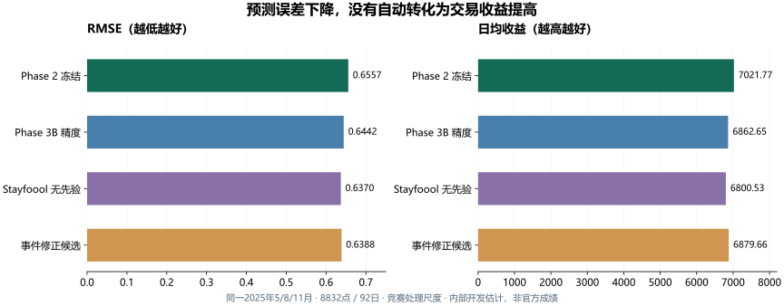

# 最新统一评价结果

更新2026-11-09。**当前保留Phase 2冻结19特征LightGBM＋CatBoost等权融合。**

## 评价口径

扩展时间验证：训练截止4月底→5月，截止7月底→8月，截止10月底→11月。各折历史末14天早停后重拟合；Optuna和权重也在对应外层历史内选择。

共同8832点合并计算MAE、RMSE、R²，92个完整日计算收益。不能把各折R²的简单平均称作总体R²。保留原始负价、零价和尖峰，不补造标签；收益仅评价完整96点日期。所有结果为内部开发估计，反复查看的历史月份不能称独立盲测。

## 同日期对照

| 方案 | R² | MAE | RMSE | rMAE_calendar | 日均收益 | 捕获率 | 负收益日 |
|---|---:|---:|---:|---:|---:|---:|---:|
| **Phase 2冻结融合** | **0.420983** | **0.450309** | **0.655694** | **0.642585** | **7021.77** | **63.93%** | **7** |
| Phase 3B精度优化 | 0.441167 | 0.438821 | 0.644164 | 0.626191 | 6862.65 | 62.48% | 7 |
| 六时段专家增量A | 0.433351 | 0.439912 | 0.648654 | 0.627747 | 6982.55 | 63.57% | 6 |
| 180天融合增量B | 0.435308 | 0.441841 | 0.647533 | 0.630501 | 6817.40 | 62.07% | 7 |
| 事件修正增量C | 0.450439 | 0.432548 | 0.638798 | 0.617239 | 6879.66 | 62.63% | 7 |
| 完整Stayfoool，无先验 | 0.453506 | 0.406726 | 0.637013 | 0.580392 | 6800.53 | 61.91% | 6 |
| 完整Stayfoool，固定先验 | 0.453506 | 0.406726 | 0.637013 | 0.580392 | 6172.41 | 56.19% | 8 |
| 完整Stayfoool，训练门控先验 | 0.453506 | 0.406726 | 0.637013 | 0.580392 | 6708.80 | 61.08% | 7 |

共同Oracle日均收益10984.231927。捕获率=策略总收益/Oracle总收益；Regret=Oracle−实际收益。未知赛题尺度不能解释为人民币。rMAE_calendar=模型MAE/训练期“星期×时段均价”基准MAE，不使用验证真实上周价。

## 精度与收益为什么不一致

完整Stayfoool相对Phase 2，MAE约下降9.68%、RMSE约下降2.85%，日均收益约下降3.15%。相对Phase 3B精度方案，RMSE改善约1.11%，收益仍下降约0.91%。

平均误差改善没有保证关键充放电窗口排序改善。这是本轮数据的观测，不代表精度无用或某模型普遍劣于另一模型。

## 尖峰与亏损

高低价事件阈值只来自训练P95/P05。主验证有112个高价事件点，上表高价召回均为0，预测阳性0，Precision未定义。不能把较高R²说成已经解决尖峰。

Phase 2有7个负收益日，完整Stayfoool无先验有6个，但后者总收益更低。少亏损一天也不自动等于收益改善。

## 已见12月诊断

| 方案 | R² | MAE | RMSE | 日均收益 |
|---|---:|---:|---:|---:|
| Phase 2冻结融合 | 0.535576 | 0.352968 | 0.613017 | 5999.58 |
| Phase 3B精度规格迁移拟合 | 0.489597 | 0.415568 | 0.642645 | 6027.85 |
| Stayfoool公平协议，无先验 | 0.550832 | 0.336350 | 0.602864 | 5933.95 |

12月已多次查看，不是盲测。未据此重新选参数、权重、策略或种子，不能用单月较高R²代表整体。

## 替换门槛与不确定性

完整复现前冻结门槛：相对最新精度方案RMSE改善至少1%且至少2/3月份胜出、收益不降；相对Phase 2收益至少＋2%、至少2/3月份胜出、最差月收益比≥90%、至少2/3种子提升、7日配对区块Bootstrap区间下界>0。

Stayfoool无先验仅1/3月份收益胜过Phase 2，收益比0.968492，7日配对收益差区间下界−854.262765；固定与门控先验也未通过。1/3/7日区块Bootstrap和多种子记录在本地研究目录保留，区间不能消除反复使用验证集的开发偏差。

## 来源与公开范围

[精确JSON](../research/results.json)、[汇总CSV来源与SHA256](../research/provenance.json)。运行标识：

- `phase2_20261108_164706`：当前冻结模型。
- `phase3b_20261108_211820`：360次TPE、精度/收益目标、多种子及策略对照。
- `github_benchmark_20261109_095018`：A/B/C增量。
- `stayfoool_reproduction_20261109_102340`：24项公开指标核对、公平验证与推理重放。

原始数据、真实逐点价格、权重与Trial数据库不公开。[复现入口](../research/README.md)重跑冻结Phase 2；后续候选公开的是可核对汇总报告，不能称一键完整实验包。

官方2026测试R²、真实收益和排名未知。[10月28日旧结果](history/2026-10-28/RESULTS.md)为11特征教学版、61日口径，不能直接与本页混比。
