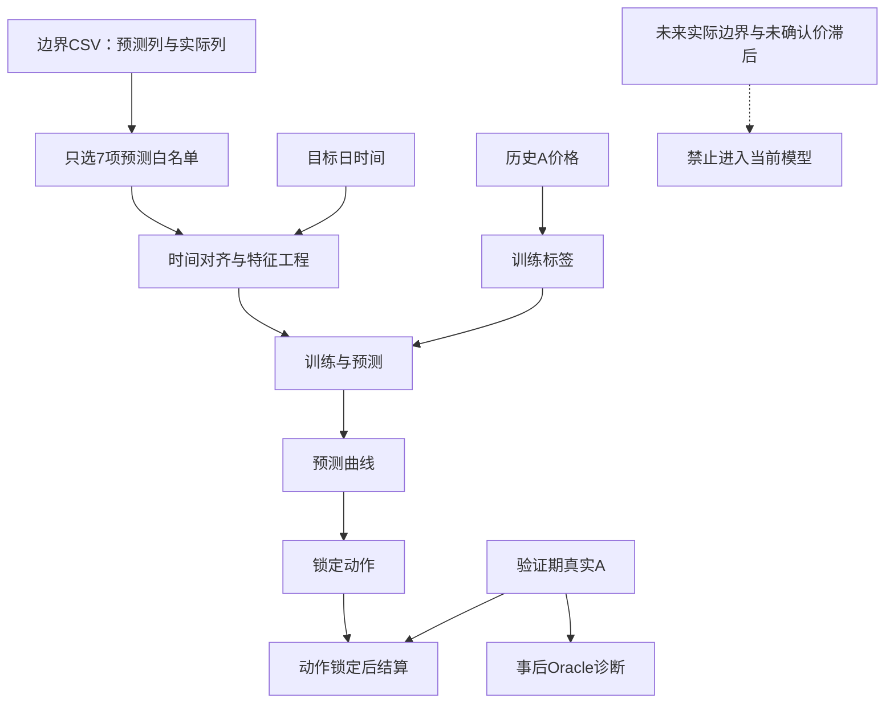
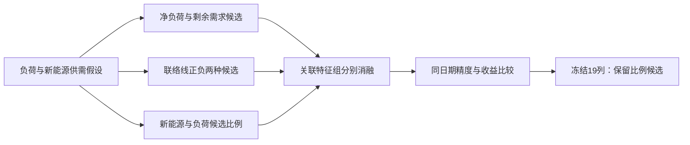
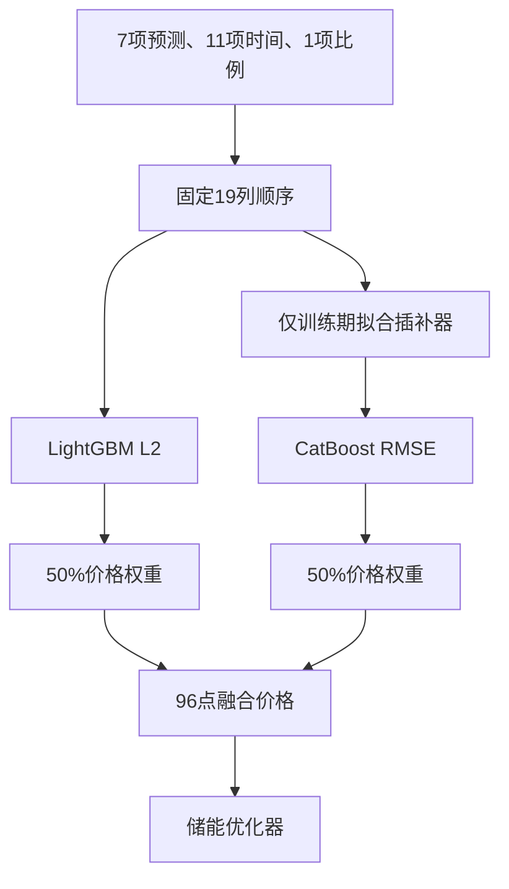
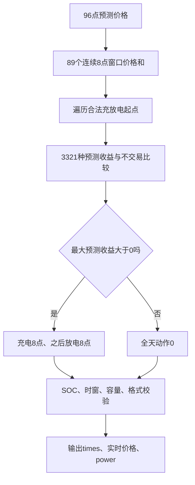
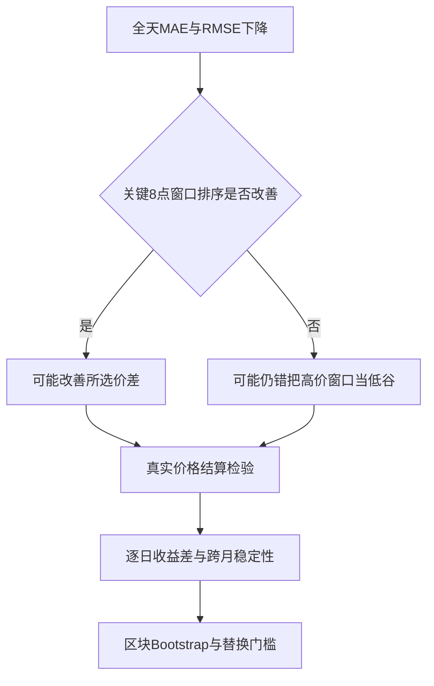

# 项目全逻辑与技术路线

按“业务目标→信息集→模型→时间验证→储能决策→结算→选择”阅读。以下描述已完成的竞赛研究；实盘扩展在最后单独标为待办。

## 图1：业务闭环

预测对象是次日实时电价，交易计划提前制定。输出既包括预测曲线，也包括合法储能动作，最终不能只按R²选模型。

## 图2：数据血缘与信息边界

CSV提供目标时间，没有可证明的发布时间或修订版本。竞赛将7列作为规定输入；实盘还需as-of数据流、标签发布延迟及决策钟点约束。

## 图3：市场机理变成可检验假设

风光总加已包括风电和光伏，不重复扣减。联络线方向、单位和缩放未明，候选差值不等于官方物理竞价空间，相关性不等于因果。

## 图4：当前冻结模型

历史价只作标签；当前没有价滞后、异常Flag或NWP输入。推理必须保持相同19列、模型权重和训练插补器，不能套用11列单模型模板。

## 图5：时间验证与早停

| 折 | 训练截止 | 验证 | 早停 |
|---|---|---|---|
| spring | 2025-04-30 | 2025年5月 | 对应历史末14天 |
| summer | 2025-07-31 | 2025年8月 | 对应历史末14天 |
| autumn | 2025-10-31 | 2025年11月 | 对应历史末14天 |
| diagnostic | 2025-11-30 | 2025年12月 | 已见诊断，不重新选型 |

Phase 3B的Optuna、早停和权重选择也在对应外层历史内完成。没有用外层早停，并不意味着反复查看的历史外层得分仍是独立盲测。

## 图6：预测曲线到合法动作

真实价格不进入动作选择。Oracle读取真实价格，计算同约束最优策略，仅用于诊断差距。

## 图7：预测与收益的联合评价

完整Stayfoool复现价格更准，但没有通过收益门槛。项目保留失败候选，不只展示最高R²。

## 图8：竞赛到实际交易的扩展路线（未完成）

这条路线不能描述为已完成的实盘能力，详见[政策对照](policy_alignment.md)。
